# System Architecture (C4 Level 2: Container Diagram)

The following diagram illustrates the architecture of the Meetings Application (Spry), incorporating the AI Agenda Parsing subsystem (Lab 6) and the Event-Driven Weekly Reporting subsystem (Lab 5).

```mermaid
C4Container
    title Container Diagram for Meetings App (Spry) with AI & Event-Driven Subsystems

    Person(user, "User", "A team member managing their calendar and scheduling meetings.")

    System_Boundary(c1, "Meetings Application") {
        Container(spa, "Single-Page Application", "React, TypeScript, Vite, Tailwind, shadcn/ui", "Provides calendar views, meeting CRUD, paste agenda UI, and on-demand report trigger.")
        Container(cloudfront, "CloudFront CDN & S3", "Amazon CloudFront, Amazon S3", "Distributes static SPA bundle globally on flat-rate Free tier.")
        
        Container(cognito, "Authentication Provider", "Amazon Cognito User Pool", "Handles user sign-up, sign-in, and issues RS256-signed JWT ID tokens.")

        Container(ai_parser, "AI Agenda Parser Lambda", "Python 3.12, Anthropic SDK (No VPC)", "Stateless Lambda function URL. Validates Cognito JWT, limits text to 10k chars, calls Bedrock Claude via record_agenda tool, logs token/cost metrics.")

        Container_Boundary(vpc, "Private VPC (No NAT)") {
            Container(api, "Backend API Lambda", "Python 3.12, FastAPI, SQLAlchemy (Private VPC)", "Runs inside private subnets. Enforces business rules, scopes data per user, saves meetings and ai_suggestion metadata.")
            ContainerDb(db, "Relational Database", "Amazon Aurora Serverless v2 PostgreSQL", "Stores users, meetings, participants, and ai_suggestion metadata.")
            Container(builder, "Report Builder Lambda", "Python 3.12 (Private VPC)", "Triggered by SQS. Queries Aurora for previous week's meetings, writes CSV to S3 via free S3 Gateway VPCEndpoint.")
            Container(s3_vpce, "S3 Gateway Endpoint", "AWS PrivateLink / Gateway VPCEndpoint", "Provides free, private route from VPC subnets directly to S3.")
        }

        ContainerDb(reports_bucket, "Reports & Requests Store", "Amazon S3", "Stores requests/<id>.json and reports/<week>_<id>.csv.")
        Container(mailer, "Report Mailer Lambda", "Python 3.12 (No VPC)", "Triggered on S3 upload. Reads CSV, composes multipart email with attachment, sends via SES.")
        ContainerQueue(queue, "Report Requests Queue", "Amazon SQS", "Buffers on-demand and scheduled report generation requests.")
        Container(scheduler, "Weekly Cron Scheduler", "Amazon EventBridge Scheduler", "Dispatches scheduled message to SQS every Monday at 08:00 UTC.")
    }

    System_Ext(bedrock, "Amazon Bedrock", "Managed Foundation Models (Anthropic Claude Opus / Haiku / Sonnet).")
    System_Ext(ses, "Amazon SES", "Simple Email Service for delivering transactional report emails.")

    Rel(user, cloudfront, "Loads app bundle over HTTPS", "HTTPS")
    Rel(cloudfront, spa, "Delivers", "Static assets")
    Rel(user, cognito, "Authenticates and receives ID token", "HTTPS / OAuth2")
    
    %% AI Flow
    Rel(user, ai_parser, "1. Pastes raw text to parse", "HTTPS / Lambda Function URL (Auth: Bearer JWT)")
    Rel(ai_parser, bedrock, "Invokes model with record_agenda tool", "HTTPS / SigV4")
    Rel(ai_parser, user, "Returns pre-filled JSON agenda", "HTTPS / JSON")
    Rel(user, api, "2. Reviews/edits form and clicks Save", "HTTPS / Lambda Function URL (Auth: Bearer JWT)")
    Rel(api, db, "Persists meeting and ai_suggestion", "PostgreSQL / Port 5432")

    %% Reporting Flow
    Rel(scheduler, queue, "Pushes scheduled report job (Mondays)", "SQS SendMessage")
    Rel(api, reports_bucket, "Writes on-demand requests/*.json", "HTTPS via S3 Gateway VPCEndpoint")
    Rel(reports_bucket, queue, "Notifies S3 ObjectCreated", "S3 Event -> SQS")
    Rel(queue, builder, "Triggers execution batch", "SQS Trigger")
    Rel(builder, db, "Queries weekly meetings", "PostgreSQL / Port 5432")
    Rel(builder, reports_bucket, "Uploads reports/*.csv", "HTTPS via S3 Gateway VPCEndpoint")
    Rel(reports_bucket, mailer, "Triggers mailer on CSV upload", "S3 Event -> Lambda")
    Rel(mailer, ses, "Sends email with attached CSV", "HTTPS")
    Rel(ses, user, "Delivers weekly report email", "SMTP")
```

